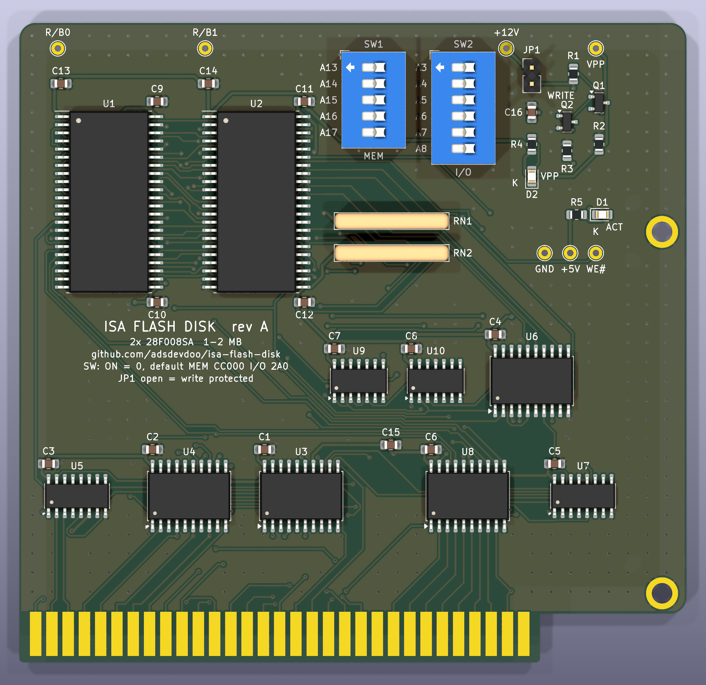
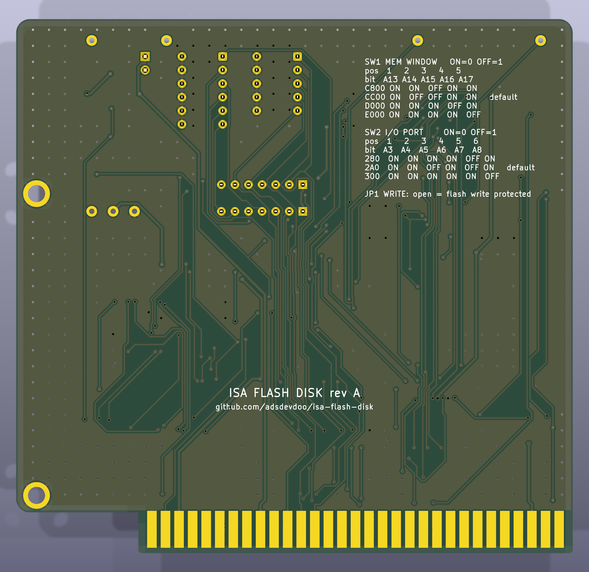

# ISA Flash Disk

8-битная ISA-карта с флеш-диском на микросхемах **Intel 28F008SA** для IBM PC XT, AT, 286, 386 и 486.
Цель — загрузка MS-DOS с карты и запись образа диска из DOS.

- 1 или 2 микросхемы PA28F008SA (PSOP-44) на карту: 1 или 2 Мбайт.
- Окно 8 Кбайт в верхней памяти + регистр банка в портах ввода-вывода.
- Собственный Option ROM: диск через INT 13h, загрузка DOS.
- Аппаратная защита от записи: без перемычки JP1 записать флеш невозможно.
- Логика 74HCT, без микроконтроллера.

## Статус

| Этап | Содержание | Состояние |
|---|---|---|
| 1. Исследование | документация, выбор архитектуры | выполнено |
| 2–3. Схема карты | 1–2 микросхемы, банки, защита записи | схема rev A: ERC 0, нетлист сверен |
| 5. Плата | разводка, DRC, Gerber | **rev A разведена: DRC 0, соответствие схеме 0 расхождений** |
| 2. Прототип | изготовление, чтение, адресация, запись | не начат |
| 4. Программы | Option ROM, FLINFO/FLREAD/FLWRITE/FLFORMAT, mkdisk | **v1.1, чтение и запись из DOS: 112 проверок в эмуляторе, на железе нет** |

**Статус: инженерный прототип rev A, не испытан в железе.** Плата 104.14 × 100 мм под планку Keystone 9202,
архив для JLCPCB — [hardware/gerber/](hardware/gerber/), параметры заказа и границы проверки —
[docs/manufacturing.md](docs/manufacturing.md). Схема — [docs/schematic.pdf](docs/schematic.pdf),
проект KiCad 9 — [hardware/kicad/](hardware/kicad/). Покупку и заказ выполняет владелец.



## Настройка переключателей

Переключатель в положении **ON = 0**, OFF = 1. Те же таблицы напечатаны на нижней стороне платы, у каждого
переключателя сверху подписан его бит адреса.

**SW1 — окно памяти 8 Кбайт** (SA19 = SA18 = 1 зашиты на плате)

| Окно | 1 (A13) | 2 (A14) | 3 (A15) | 4 (A16) | 5 (A17) |
|---|---|---|---|---|---|
| C8000h | ON | ON | OFF | ON | ON |
| **CC000h (по умолчанию)** | ON | OFF | OFF | ON | ON |
| D0000h | ON | ON | ON | OFF | ON |
| E0000h | ON | ON | ON | ON | OFF |

**SW2 — порты ввода-вывода** (8 портов; SA9 = 1 зашит, AEN = 0)

| Порты | 1 (A3) | 2 (A4) | 3 (A5) | 4 (A6) | 5 (A7) | 6 (A8) |
|---|---|---|---|---|---|---|
| 280h | ON | ON | ON | ON | OFF | ON |
| **2A0h (по умолчанию)** | ON | ON | OFF | ON | OFF | ON |
| 300h | ON | ON | ON | ON | ON | OFF |

Остальные адреса — по битам: окно C0000h…FE000h с шагом 8 Кбайт, порты 200h…3F8h с шагом 8
([docs/memory-map.md](docs/memory-map.md)). **JP1 WRITE** снята — флеш защищена от записи; ставится только на время
записи утилитами.



## Заказ платы (на примере JLCPCB)

Загружается готовый архив [hardware/gerber/isa-flash-disk-revA-jlcpcb.zip](hardware/gerber/isa-flash-disk-revA-jlcpcb.zip),
в Gerber для этого ничего менять не нужно. Краевой разъём требует двух вещей:

- **Контур разъёма** — выступ с ламелями и уступы по бокам — уже нарисован в слое Edge.Cuts. Его фрезеруют
  вместе с остальным контуром платы, отдельной опции для этого нет.
- **Фаска (скос) края с ламелями**, чтобы карта входила в слот, не сдирая контакты. Это отдельная опция заказа
  вместе с золочением ламелей.

| Поле формы заказа | Значение |
|---|---|
| Base Material / Layers | FR-4 / 2 |
| PCB Thickness | 1.6 mm (стандарт ISA) |
| Outer Copper Weight | 1 oz |
| Surface Finish | **ENIG** — только с ним ламели будут золотыми; при HASL они лужёные |
| Gold Fingers | **Yes** — открывает выбор фаски |
| Угол фаски | **30°** (рекомендация JLCPCB) или 45° — оба помещаются в отступ ламелей |
| Delivery Format / Panel | одиночные платы, **без панелизации V-cut**: в панели разъём оказался бы в середине и фаску не сделать |

Справка JLCPCB ([Gold Fingers](https://jlcpcb.com/help/article/jlcpcb-gold-fingers), ноябрь 2026): фаска делается
на платах не меньше 50 × 50 мм (у нас 104 × 100 мм); в зоне фаски не должно быть меди; между ламелями и краем
нужен запас, точного числа справка не даёт. На плате ламели заканчиваются в 1.0 мм от края, а меди в нижних
0.9 мм нет. При толщине 1.6 мм и остатке кромки 0.5 мм фаска 30° уходит вглубь примерно на 0.95 мм, 45° —
на 0.55 мм. Названия полей формы JLCPCB иногда меняет, поэтому перед оплатой проверьте превью и параметры
заказа. В примечание к заказу можно написать: «Gold fingers on the bottom edge (8-bit ISA connector), bevel 30°».
Остальные параметры и что проверено — в [docs/manufacturing.md](docs/manufacturing.md).

## Документация

| Файл | Что внутри |
|---|---|
| [docs/research.md](docs/research.md) | источники, находки, решения и открытые вопросы этапа 1 |
| [docs/intel-28f008sa.md](docs/intel-28f008sa.md) | характеристики микросхемы со ссылками на страницы даташита |
| [docs/original-module.md](docs/original-module.md) | исходный модуль и снятие микросхем |
| [docs/architecture.md](docs/architecture.md) | сравнение вариантов, выбранная схема, защита, VPP |
| [docs/isa-interface.md](docs/isa-interface.md) | шина ISA: контакты, циклы, питание, Option ROM |
| [docs/memory-map.md](docs/memory-map.md) | адреса окна и портов, регистры, разметка флеш |
| [docs/programming.md](docs/programming.md) | Option ROM, утилиты DOS, первая запись ПЗУ, запись на диск из DOS |
| [docs/testing.md](docs/testing.md) | замеры и проверки |
| [docs/assembly.md](docs/assembly.md) | сборка карты |
| [docs/manufacturing.md](docs/manufacturing.md) | заказ платы в JLCPCB, что проверено |
| [docs/models.md](docs/models.md) | 3D-модели и их ограничения |

Даташиты и руководства IBM лежат в [docs/datasheets/](docs/datasheets/) и [docs/references/](docs/references/).

## Структура

```
docs/          документация, даташиты, руководства
hardware/      kicad/, gerber/, bom/
firmware/      option-rom/ — Option ROM (NASM)
software/      dos/ — утилиты DOS (NASM)
tools/         вспомогательные скрипты для сборки и проверки
```

Документация на русском, исходный код и идентификаторы — на английском.
Рабочие правила проекта — [AGENTS.md](AGENTS.md).

## Лицензия

[MIT](LICENSE). Документы Intel, IBM, TI, AOS и onsemi в `docs/datasheets/` и `docs/references/` под эту
лицензию не подпадают и принадлежат их владельцам.
