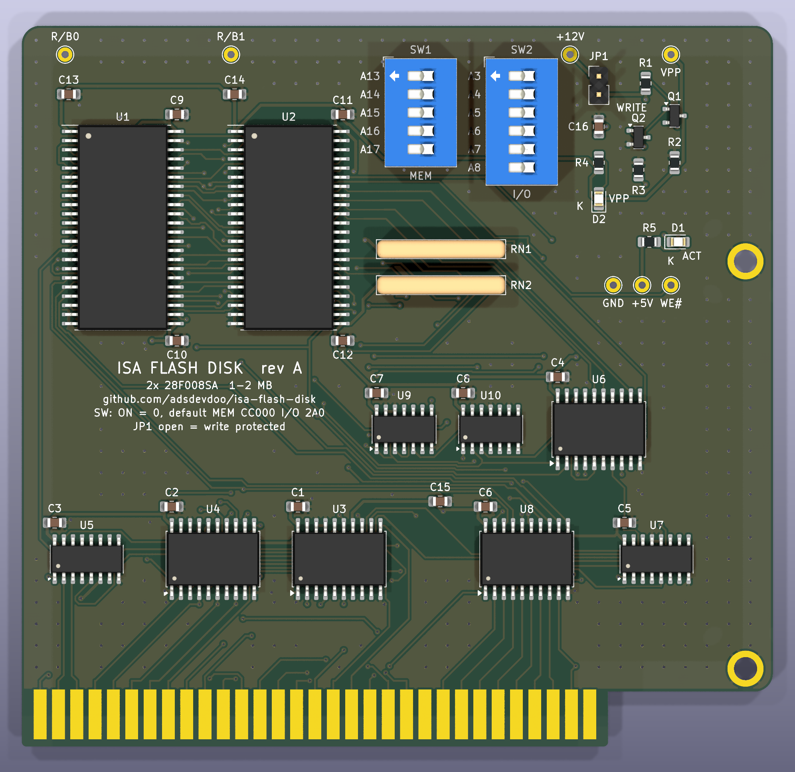

# Изготовление платы

Статус: **rev A разведена, DRC без нарушений. Это прототип: в железе не проверялась**, проверка DFM самим JLCPCB
не проводилась. Сначала заказывать малую партию и проходить проверки из [testing.md](testing.md).

Архив для заказа: [hardware/gerber/isa-flash-disk-revA-jlcpcb.zip](../hardware/gerber/isa-flash-disk-revA-jlcpcb.zip)
(7 слоёв Gerber и сверловка Excellon). Рендеры — в [images/](../images/), это CAD-изображения, а не фотографии.

## Механика

| Параметр | Значение | Основание |
|---|---|---|
| Габарит | **104.14 × 100.00 мм** (по Edge.Cuts) | геометрия XT-CF-Lite V4 под Keystone 9202 ([isa-interface.md](isa-interface.md)); высота — предел владельца 100 мм |
| Ламели A1…A31 / B1…B31 | центры 78.74 … 2.54 мм от дальнего края, шаг 2.54, ширина 1.78 мм | XT 1-31, KiCad BUS_AT |
| Ламели по высоте | от 1.0 до 7.9 мм над краем | отступ под фаску, ниже |
| Отверстия под планку | Ø 3.2 мм, металлизированные, площадка 5 мм на GND; 3.81 мм от края планки, на 10.80 и 67.31 мм над краем ламелей | шаг 2.225" под Keystone 9202 |
| Компоненты | только сверху, логика SOIC, пассивные 0805 с площадками для ручной пайки | |

## Заказ в JLCPCB

| Параметр | Значение |
|---|---|
| Материал, слои | FR-4, 2 слоя |
| Толщина | 1.6 мм (стандарт ISA) |
| Медь | 1 oz |
| Покрытие | **ENIG** — только с ним ламели получаются золотыми; при HASL они будут лужёные |
| Gold fingers / фаска | да, **30°** (рекомендация JLCPCB; доступны 30° и 45°) |
| Маска, шелкография | зелёная / белая, с обеих сторон |
| Переходные | сквозные, сверло 0.3 мм (сигналы) и 0.4 мм (питание), без blind/buried |

Правила JLCPCB для ламелей ([справка](https://jlcpcb.com/help/article/jlcpcb-gold-fingers), ноябрь 2026):
плата с ламелями не меньше 50 мм по длине и ширине; в зоне фаски нет меди; над ламелями маска открыта; между
ламелями и краем нужен запас. Точной величины запаса в тексте справки нет (она на картинке), поэтому ламели
заканчиваются в 1.0 мм от края: при 1.6 мм, остатке 0.5 мм и угле 30° фаска снимает около
(0.8 − 0.25) / tan 30° ≈ 0.95 мм.

Правила разводки (retro535 и возможности JLCPCB): дорожка ≥ 0.2 мм (сигналы 0.25, питание 0.4), зазор 0.2 мм,
медь до края ≥ 0.3 мм, переходные 0.7/0.3 мм (питание 0.8/0.4), текст шелкографии 1.0 мм, линия 0.15 мм.
Земля залита с двух сторон и сшита сеткой переходных 0.8/0.4 мм с шагом 3 мм: остаются только те, что попали в заливку на обоих слоях, поэтому куски заливки между дорожками не удаляются как острова. На ламелях запрещены переходные и заливка, у ламелей собственный зазор 0.3 мм, поэтому дорожки между ними
не проходят; в полосе фаски (нижние 0.9 мм) меди нет.

## Что проверено

| Проверка | Результат |
|---|---|
| ERC схемы | 0 ошибок, 0 предупреждений ([erc.rpt](../hardware/kicad/reports/erc.rpt)) |
| Нетлист против таблицы соединений | 81 цепь, 0 расхождений ([netlist-check.txt](../hardware/kicad/reports/netlist-check.txt)) |
| DRC платы + соответствие схеме | 0 нарушений, 0 неразведённых, 0 ошибок футпринтов ([drc.rpt](../hardware/kicad/reports/drc.rpt)) |
| Контур в Gerber | 104.14 × 100.00 мм |
| Сверловка | 491 переходное (161 × 0.3, 330 × 0.4, из них 302 — сшивка земли), 36 × 0.8 (SW1, SW2, RN1, RN2), 9 × 1.0 (TP1–TP7, JP1), 2 × 3.2 (H1, H2); NPTH нет |
| Шелкография | рендеры обеих сторон просмотрены, подписи не перекрываются и не лежат на площадках |

## Что не проверено

- Плата не изготавливалась; работа в XT/AT/386/486 не испытана.
- Проверка DFM на стороне JLCPCB и просмотр Gerber в их просмотрщике.
- Запас ламелей до фаски — по формуле, а не по чертежу JLCPCB.
- Удержание данных при записи и +12 В на реальных машинах ([testing.md](testing.md)).

Не заказывать, не оплачивать и не загружать файлы без поручения владельца.
